# Девятая лабораторная работа

Логинимся:

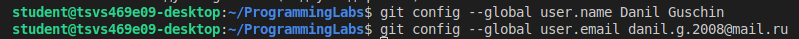

Выбираем основной текстовый редактор:
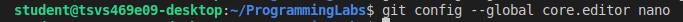

# На оценку 3

1. Используем git status для проверки, на какой ветке мы находимся:
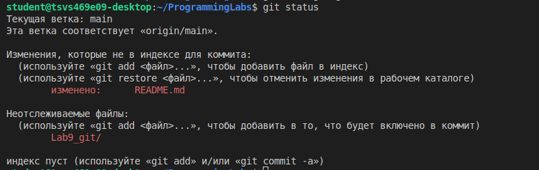
2. Посмотрим, как выглядит git log:
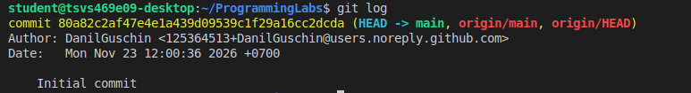
3. Создадим новый файл sort.c и вставим туда функцию сортировки:
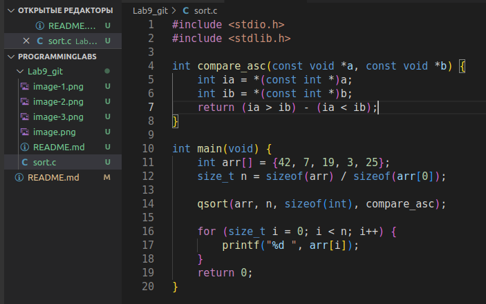
4. Проверим, как теперь выглядит git status:
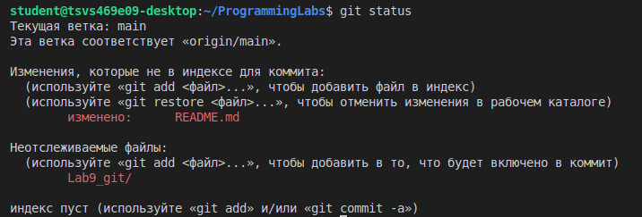
5. Добавим файл sort.c в область stage и снова проверим git status:
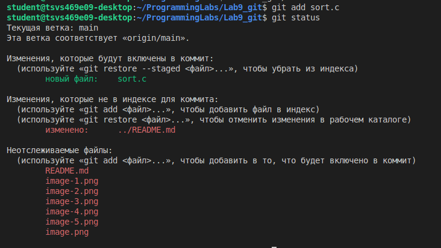
6. Закоммитим файл и проверим git status:
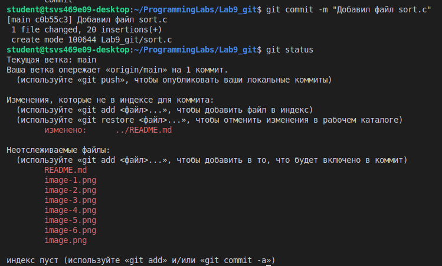
7. Добавим комментарий в файл и еще раз проверим git status:
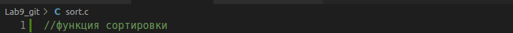
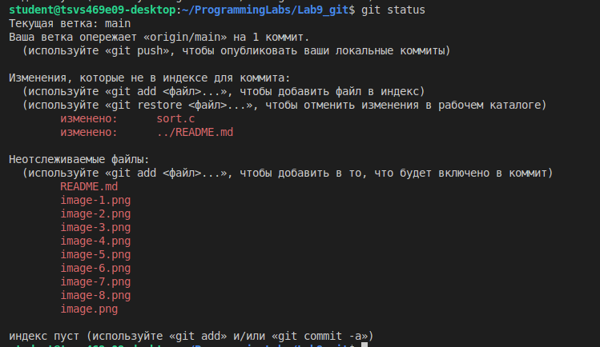
8. Сделаем add для измененного файла и проверим git status:
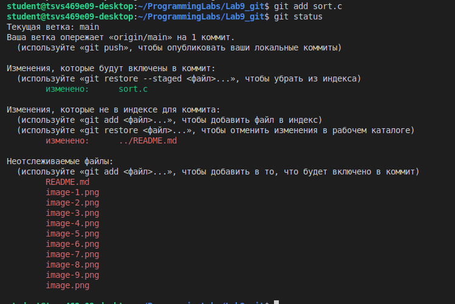
9. Изменим файл еще раз (удалим старый комментарий), сделаем коммит:
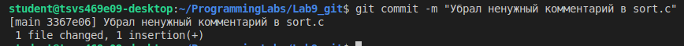
10. Проверим, как сейчас выглядит git status и git log:
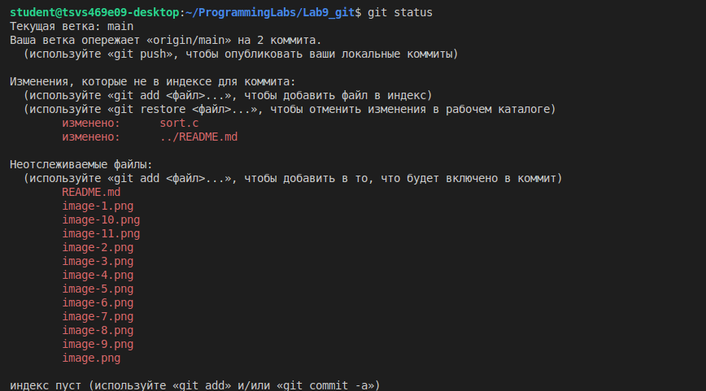
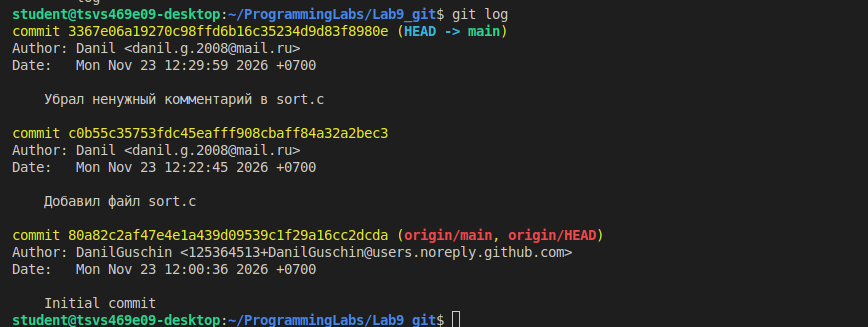
11. Добавим в stage и закоммитим последнее изменение:
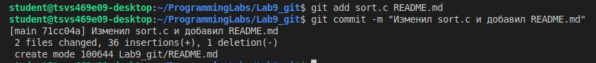
12. Запушим всё в наш репозиторий:
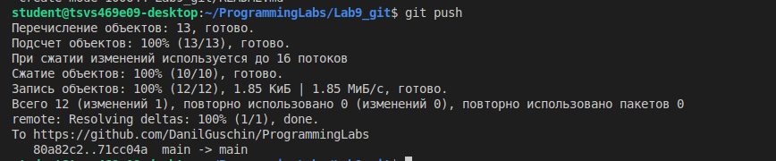
